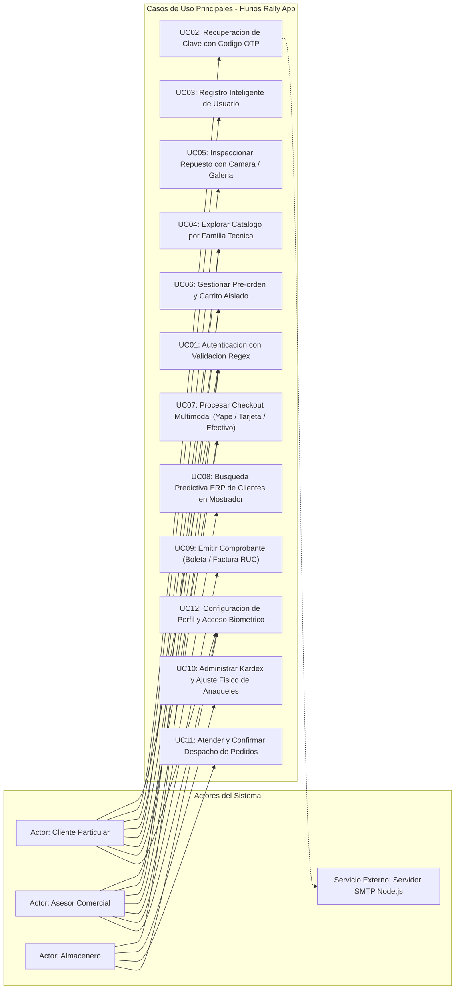
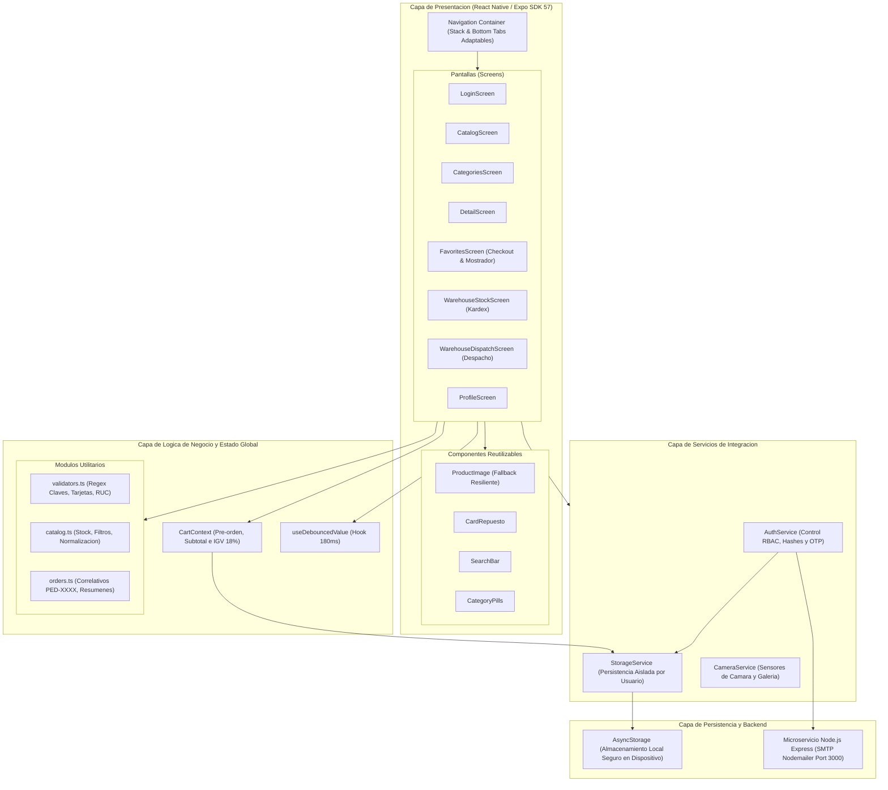
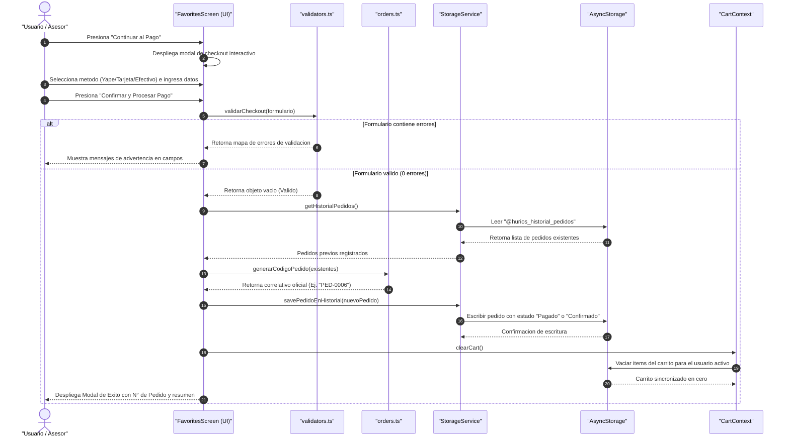
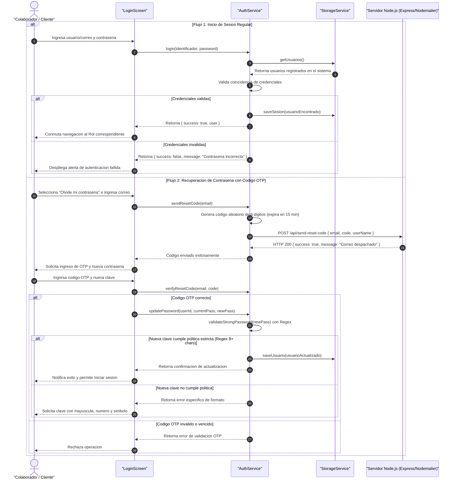
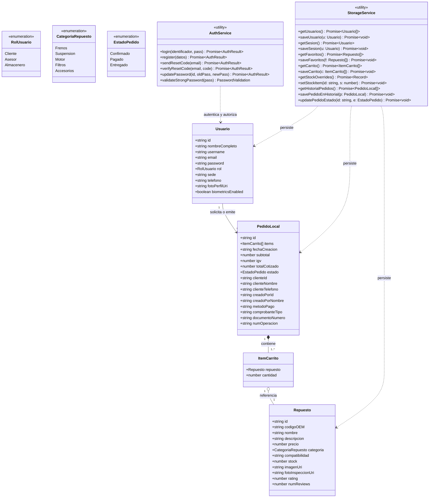
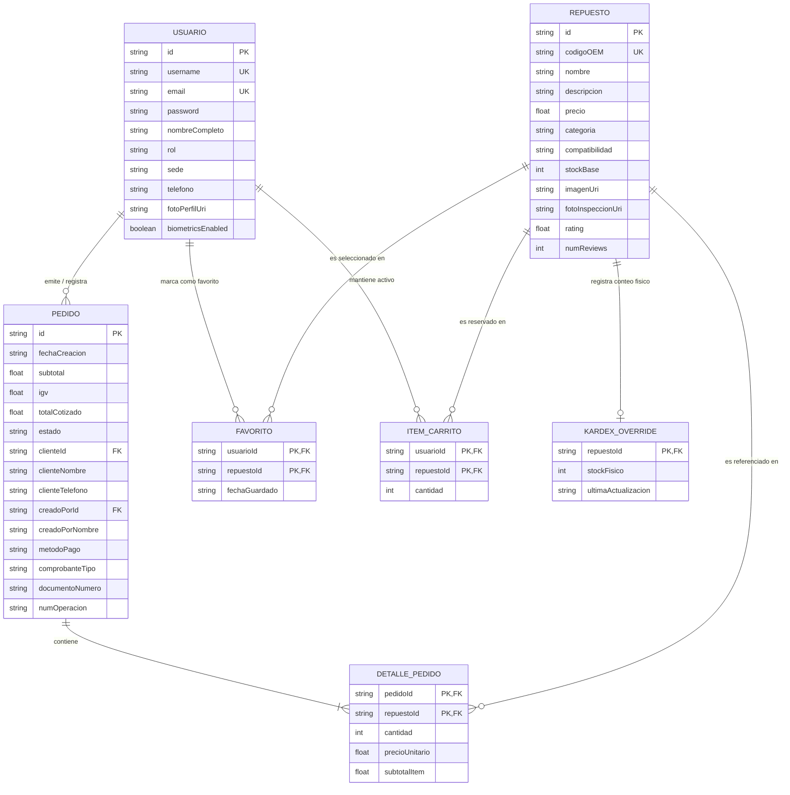
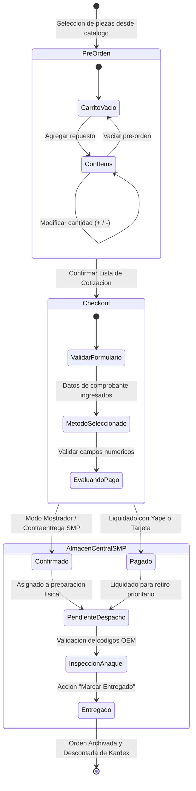
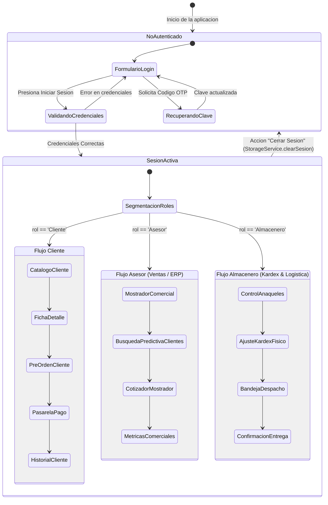
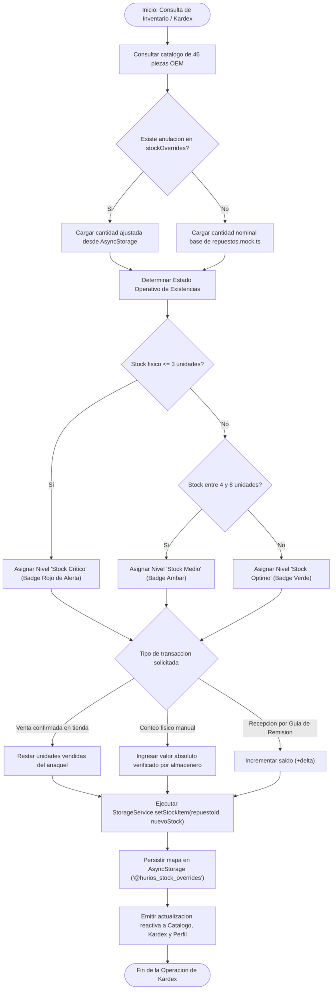

# Sistema Móvil de Comercio, Cotización ERP y Control de Almacén

[](https://reactnative.dev/)
[](https://expo.dev/)
[](https://www.typescriptlang.org/)
[](https://nodejs.org/)
[](https://martinfowler.com/bliki/PresentationDomainDataLayering.html)
[](https://www.iso.org/standard/35733.html)

**Entidad Titular:** HURIOS RALLY E.I.R.L.  
**RUC:** 20608542191  
**Ubicación:** Av. Perú 2450, San Martín de Porres, Lima Norte  
**Plataforma de Ejecución:** Android / iOS (Motor React Native sobre Expo Go)  

---

## Índice General

1. [Introducción y Descripción del Sistema](#1-introducción-y-descripción-del-sistema)
2. [Especificación de Requisitos y Alcance Funcional](#2-especificación-de-requisitos-y-alcance-funcional)
3. [Diagramas de Ingeniería de Software (UML & Arquitectura)](#3-diagramas-de-ingeniería-de-software-uml--arquitectura)
   - [3.1. Diagrama de Casos de Uso del Sistema](#31-diagrama-de-casos-de-uso-del-sistema)
   - [3.2. Diagrama de Arquitectura de Capas y Componentes](#32-diagrama-de-arquitectura-de-capas-y-componentes)
   - [3.3. Diagrama de Secuencia: Proceso de Cotización, Checkout y Registro de Pedido](#33-diagrama-de-secuencia-proceso-de-cotización-checkout-y-registro-de-pedido)
   - [3.4. Diagrama de Secuencia: Autenticación, Verificación Regex y Recuperación SMTP](#34-diagrama-de-secuencia-autenticación-verificación-regex-y-recuperación-smtp)
   - [3.5. Diagrama de Clases del Dominio](#35-diagrama-de-clases-del-dominio)
   - [3.6. Diagrama de Entidad - Relación de Persistencia](#36-diagrama-de-entidad---relación-de-persistencia)
   - [3.7. Diagrama de Máquina de Estados del Pedido y Ciclo de Despacho](#37-diagrama-de-máquina-de-estados-del-pedido-y-ciclo-de-despacho)
   - [3.8. Diagrama de Estados de Sesión y Control de Acceso basado en Roles (RBAC)](#38-diagrama-de-estados-de-sesión-y-control-de-acceso-basado-en-roles-rbac)
   - [3.9. Diagrama de Actividades: Flujo del Control de Inventario y Kardex](#39-diagrama-de-actividades-flujo-del-control-de-inventario-y-kardex)
4. [Matriz de Roles y Control de Acceso (RBAC)](#4-matriz-de-roles-y-control-de-acceso-rbac)
5. [Cuentas Maestras del Sistema y Credenciales de Evaluación](#5-cuentas-maestras-del-sistema-y-credenciales-de-evaluación)
6. [Pila Tecnológica y Dependencias](#6-pila-tecnológica-y-dependencias)
7. [Estructura y Organización del Código Fuente](#7-estructura-y-organización-del-código-fuente)
8. [Guía de Instalación, Configuración y Despliegue](#8-guía-de-instalación-configuración-y-despliegue)
9. [Ciclo de Vida del Software y Control de Versiones](#9-ciclo-de-vida-del-software-y-control-de-versiones)
10. [Información Institucional y Licencia](#10-información-institucional-y-licencia)

---

## 1. Introducción y Descripción del Sistema

**Hurios Rally App** es una solución de software móvil multiplataforma desarrollada bajo la disciplina de la Ingeniería de Software para responder a las exigencias operativas y comerciales de **HURIOS RALLY E.I.R.L.**, empresa importadora y distribuidora de repuestos de alto rendimiento automotriz con sede principal en San Martín de Porres (Lima, Perú).

El sistema consolida en una sola aplicación reactiva los tres pilares del negocio:
1. **Comercio Minorista Digital:** Catálogo técnico clasificado por códigos OEM y familias automotrices, con cotización en tiempo real y pasarela multimodal.
2. **Atención en Mostrador (Modo Asesor / ERP):** Interfaz ágil para emisión de proformas presenciales con búsqueda predictiva de clientes registrados, selección de tipo de comprobante (Boleta / Factura con validación RUC) y confirmación de reserva.
3. **Logística y Control de Kardex (Modo Almacenero):** Monitoreo físico de anaqueles por lote, gestión de umbrales de stock crítico y validación de órdenes para despacho inmediato en tienda.

---

## 2. Especificación de Requisitos y Alcance Funcional

| Módulo | Requisito Funcional | Descripción Técnica |
| :--- | :--- | :--- |
| **RF-01** | Autenticación Segura | Inicio de sesión con evaluación Regex de complejidad (mínimo 8 caracteres, mayúscula, minúscula, número y símbolo especial). |
| **RF-02** | Registro Inteligente | Generación algorítmica de credenciales corporativas (`nombre_apellido` y dominio corporativo según rol). |
| **RF-03** | Recuperación OTP | Despacho de código de seguridad de 6 dígitos mediante microservicio SMTP con debounce anti-duplicados. |
| **RF-04** | Catálogo Técnico | 46 piezas OEM en 5 categorías (*Frenos, Suspensión, Motor, Filtros, Accesorios*) con búsqueda debounced (180 ms). |
| **RF-05** | Inspección Visual | Captura de imagen in situ mediante cámara del dispositivo o selección desde galería para asociar fotos a lotes. |
| **RF-06** | Pre-orden & Carrito | Contexto global (`CartContext`) con cálculo automático de Subtotal, IGV (18%) y totalización aislada por usuario. |
| **RF-07** | Pasarela Multimodal | Soporte para Yape/Plin (registro de operación), Tarjeta Débito/Crédito (validación 16 dígitos y CVV) y Contraentrega. |
| **RF-08** | ERP de Mostrador | Selector predictivo de clientes registrados con dropdown de iniciales y autocompletado de razón social y teléfono. |
| **RF-09** | Kardex en Tiempo Real | Sincronización bidireccional de anaqueles, ajuste manual de conteo físico y alerta de stock crítico (≤ 3 unid.). |
| **RF-10** | Control de Despacho | Filtrado de órdenes (*Pendientes, Despachados, Todos*) con acción irreversible de confirmación de entrega física. |

---

## 3. Diagramas de Ingeniería de Software (UML & Arquitectura)

### 3.1. Diagrama de Casos de Uso del Sistema

Representa las interacciones entre los actores del sistema y los casos de uso fundamentales que cubren la operación comercial y logística.



---

### 3.2. Diagrama de Arquitectura de Capas y Componentes

Ilustra la separación de responsabilidades bajo una arquitectura en capas desacoplada, donde la vista móvil consume servicios independientes y persiste de manera local y remota.



---

### 3.3. Diagrama de Secuencia: Proceso de Cotización, Checkout y Registro de Pedido

Detalla las invocaciones sincronizadas y asíncronas para validar los datos financieros, descontar stock en Kardex y persistir el pedido en el historial.



---

### 3.4. Diagrama de Secuencia: Autenticación, Verificación Regex y Recuperación SMTP

Describe el ciclo de vida del inicio de sesión institucional y la recuperación de clave mediante código de un solo uso (OTP) despachado por el microservicio de correos.



---

### 3.5. Diagrama de Clases del Dominio

Estructura de clases, interfaces, tipos enumerados y dependencias que conforman el modelo de dominio en TypeScript estricto.



---

### 3.6. Diagrama de Entidad - Relación de Persistencia

Modela los almacenes clave-valor y registros normalizados que el sistema persiste de forma asíncrona en el almacenamiento interno del dispositivo.



---

### 3.7. Diagrama de Máquina de Estados del Pedido y Ciclo de Despacho

Muestra las transiciones que experimenta una orden de repuestos desde su gestación en el carrito hasta su entrega física final en los anaqueles de SMP.



---

### 3.8. Diagrama de Estados de Sesión y Control de Acceso basado en Roles (RBAC)

Modela el ciclo de vida de la sesión de usuario y la segregación estricta de navegación según el rol asignado.



---

### 3.9. Diagrama de Actividades: Flujo del Control de Inventario y Kardex

Especifica la lógica de negocio para la gestión física de existencias y la activación de alertas preventivas en anaqueles.



---

## 4. Matriz de Roles y Control de Acceso (RBAC)

El sistema implementa una matriz de privilegios basada en perfiles para garantizar la integridad operativa:

| Operación / Vista del Sistema | Cliente | Asesor de Ventas | Almacenero |
| :--- | :---: | :---: | :---: |
| **Exploración de Catálogo y Búsqueda OEM** | Sí | Sí | No |
| **Inspección de Piezas con Cámara / Galería** | Sí | Sí | No |
| **Generación de Pre-orden y Lista de Deseos** | Sí | Sí | No |
| **Checkout Multimodal (Yape, Tarjeta, Mostrador)** | Sí | Sí | No |
| **Buscador Predictivo de Clientes Registrados (ERP)** | No | Sí | No |
| **Emisión de Cotizaciones en Mostrador con RUC** | No | Sí | No |
| **Visualización de Métricas de Venta y Proformas** | No | Sí | No |
| **Inventario Físico de Anaqueles y Kardex Sede SMP** | No | No | Sí |
| **Ajuste Manual e Incremental de Stock Físico** | No | No | Sí |
| **Bandeja de Despacho y Marcado de Pedidos Entregados** | No | No | Sí |
| **Configuración de Perfil y Acceso Biométrico** | Sí | Sí | Sí |

---

## 5. Cuentas Maestras del Sistema y Credenciales de Evaluación

Para auditorías académicas y pruebas de evaluación, el archivo `StorageService.ts` auto-inicializa tres cuentas maestras predeterminadas. Los botones de acceso rápido en el `LoginScreen` cargan sus credenciales con un solo toque:

| N° | Rol | Nombre Completo | Usuario (`username`) | Correo Corporativo | Contraseña Institucional | Sede Operativa |
| :---: | :--- | :--- | :--- | :--- | :---: | :--- |
| **1** | **Cliente** | Carlos Mendoza Silva | `carlos_mendoza` | `carlos_mendoza.cliente@huriosrally.com` | `Hurios@2026` | Lima Norte / SMP (Sede Central) |
| **2** | **Asesor** | Edu Morales Carlos | `edu_morales` | `edu_morales.ventas@huriosrally.com` | `Hurios@2026` | Lima Norte / SMP (Sede Central) |
| **3** | **Almacenero** | Raúl Quispe Huamán | `raul_quispe` | `raul_quispe.almacen@huriosrally.com` | `Hurios@2026` | Almacén Central / Despacho SMP |

> **Directriz de Seguridad (Regex Estricto):**  
> Todas las contraseñas del sistema deben superar la regla de validación de complejidad:  
> `^(?=.*[a-z])(?=.*[A-Z])(?=.*\d)(?=.*[!@#$%^&*(),.?":{}|<>_\-]).{8,}$`  
> (Mínimo 8 caracteres, 1 mayúscula, 1 minúscula, 1 número y 1 símbolo).
>
> Para acceder al banco de datos con 5 usuarios de prueba listos para registro y casos de prueba detallados, consulte la [Guía de Pruebas de Usuarios](docs/pruebas_usuarios.md).

---

## 6. Pila Tecnológica y Dependencias

| Componente | Tecnología | Versión | Propósito en el Proyecto |
| :--- | :--- | :---: | :--- |
| **Núcleo Móvil** | React Native | 0.86.3 | Framework de renderizado nativo declarativo |
| **Plataforma SDK** | Expo | 57.0.24 | Entorno de empaquetado, sensores y runtime |
| **Tipado Estricto** | TypeScript | 6.0.3 | Tipado estático y compilación segura en todo el codebase |
| **Enrutamiento** | React Navigation | 7.0.14 | Navegación nativa por Stack y Bottom Tabs dinámicas |
| **Persistencia Local** | AsyncStorage | 2.2.0 | Almacenamiento clave-valor asíncrono y desacoplado |
| **Cámara & Galería** | Expo Camera / ImagePicker | 57.0.x | Captura de evidencias de piezas automotrices |
| **Iconografía** | Expo Vector Icons (Ionicons) | 15.0.2 | Simbología vectorial técnica estandarizada |
| **Servidor SMTP** | Node.js / Express | 18+ | Microservicio REST para despacho de códigos OTP |
| **Cliente de Correo** | Nodemailer | 6.9.x | Envío seguro de plantillas HTML transaccionales |

---

## 7. Estructura y Organización del Código Fuente

```text
hurios-rally-app/
├── assets/                          # Logotipos corporativos y assets gráficos
├── docs/                            # Documentación formal de ingeniería y pruebas
│   ├── diagramas_ingenieria.md      # Especificación completa de diagramas UML
│   └── pruebas_usuarios.md          # Protocolos de prueba y banco de usuarios
├── server/                          # Microservicio backend SMTP (Node.js Express)
│   ├── package.json                 # Dependencias del servidor de correos
│   └── server.js                    # Endpoints /api/send-reset-code y salud
├── src/
│   ├── components/                  # Componentes reutilizables modulares
│   │   ├── CardRepuesto.tsx         # Tarjeta de pieza con precio, OEM y stock
│   │   ├── CategoryPills.tsx        # Selector horizontal de familias automotrices
│   │   ├── ProductImage.tsx         # Renderizador de imágenes con fallback
│   │   └── SearchBar.tsx            # Barra de búsqueda con limpieza rápida
│   ├── context/
│   │   └── CartContext.tsx          # Estado reactivo global de pre-orden e IGV
│   ├── data/
│   │   └── repuestos.mock.ts        # Catálogo canónico de 46 piezas OEM
│   ├── hooks/
│   │   └── useDebouncedValue.ts     # Hook de optimización de búsquedas (180ms)
│   ├── navigation/
│   │   └── RootNavigator.tsx        # Orquestación de navegación condicionada por rol
│   ├── screens/                     # Pantallas del sistema por actor
│   │   ├── CatalogScreen.tsx        # Catálogo general con búsqueda debounced
│   │   ├── CategoriesScreen.tsx     # Explorador de familias de repuestos
│   │   ├── DetailScreen.tsx         # Ficha técnica, compatibilidad e inspección
│   │   ├── FavoritesScreen.tsx      # Pre-orden, checkout y mostrador comercial
│   │   ├── LoginScreen.tsx          # Autenticación, registro y recuperación OTP
│   │   ├── ProfileScreen.tsx        # Auditoría de cuenta, biometría y métricas
│   │   ├── SavedFavoritesScreen.tsx # Lista personal de piezas destacadas
│   │   ├── WarehouseDispatchScreen.tsx # Monitoreo y despacho de pedidos
│   │   └── WarehouseStockScreen.tsx # Kardex físico y control de anaqueles
│   ├── services/                    # Capa de infraestructura y acceso a datos
│   │   ├── AuthService.ts           # Lógica de login, hashes, OTP y Regex
│   │   ├── CameraService.ts         # Integración nativa con cámara y álbum
│   │   └── StorageService.ts        # Abstracción de persistencia con AsyncStorage
│   ├── theme/
│   │   └── colors.ts                # Paleta de colores institucionales de Rally
│   ├── types/
│   │   └── index.ts                 # Contratos, interfaces y tipos TypeScript
│   └── utils/                       # Utilidades puras de lógica matemática
│       ├── catalog.ts               # Cálculos de stock, filtros y normalización
│       ├── orders.ts                # Generador de correlativos PED-XXXX y KPI
│       └── validators.ts            # Validadores de Regex, tarjetas y comprobantes
├── App.tsx                          # Punto de entrada principal y proveedores
├── app.json                         # Manifiesto de configuración de Expo
├── package.json                     # Declaración de dependencias de la app móvil
└── tsconfig.json                    # Reglas del compilador TypeScript
```

---

## 8. Guía de Instalación, Configuración y Despliegue

### Requisitos Previos del Entorno
- **Node.js**: Versión 18.x LTS o superior.
- **npm**: Versión 9.x o superior.
- **Dispositivo Físico o Emulador**:
  - Dispositivo móvil Android/iOS con la aplicación **Expo Go** instalada.
  - O emulador Android Studio / Xcode configurado en el sistema anfitrión.

### Paso 1: Clonar el Repositorio
```bash
git clone https://github.com/EduMoralesCar/HuriosRally-App.git
cd HuriosRally-App
```

### Paso 2: Instalar Dependencias de la Aplicación Móvil
```bash
npm install
```

### Paso 3: Verificar Tipado Estricto de TypeScript
```bash
npx tsc --noEmit
```
*(Debe retornar código de salida `0` sin advertencias).*

### Paso 4: Iniciar el Servidor de Desarrollo Expo
```bash
npx expo start -c
```
- Presione `a` para abrir en emulador Android.
- O escanee el código QR desplegado en terminal desde la aplicación **Expo Go** en su smartphone.

### Paso 5 (Opcional): Iniciar el Microservicio Local de Correos SMTP
Si desea probar el despacho real de correos mediante SMTP corporativo:
```bash
cd server
npm install
node server.js
```
El servidor quedará a la escucha en el puerto `3000` con el endpoint de salud `GET /` activo.

---

## 9. Ciclo de Vida del Software y Control de Versiones

El desarrollo del proyecto se rige estrictamente por la metodología **GitFlow** y la especificación de **Commits Convencionales**:

- **Rama `main`**: Contiene exclusivamente versiones estables aprobadas para pase a producción (Releases oficiales).
- **Rama `dev`**: Rama troncal de integración continua donde se consolidan los módulos probados.
- **Ramas `feature/*`**: Ramas atómicas de desarrollo por capacidad funcional (ej. `feature/app-optimization-and-clean-ui`, `feature/auth-security-and-cart-isolation`).
- **Ramas `fix/*`**: Correcciones quirúrgicas de bugs detectados durante pruebas de integración.

### Estándar de Mensajes de Confirmación (Commits)
- `feat(modulo): descripcion en espanol del nuevo requerimiento`
- `fix(modulo): correccion de defecto o excepcion de ejecucion`
- `docs(modulo): documentacion de ingenieria, diagramas o manuales`
- `refactor(modulo): optimizacion de codigo sin alterar la logica funcional`

---

## 10. Información Institucional y Licencia

Este software ha sido diseñado y desarrollado para fines académicos y corporativos como solución técnica integral para **HURIOS RALLY E.I.R.L.**

```text
Entidad: HURIOS RALLY E.I.R.L.
RUC: 20608542191
Sede Central: Av. Perú 2450, San Martín de Porres, Lima, Perú
Contacto Corporativo: ventas@huriosrally.com | (01) 534-8920
Año de Publicación: 2026
```

Todos los derechos de propiedad intelectual, diseño estructural y código fuente corresponden a **HURIOS RALLY E.I.R.L.** y a los desarrolladores asignados al proyecto. Prohibida su reproducción total o parcial sin autorización expresa de la titular.
