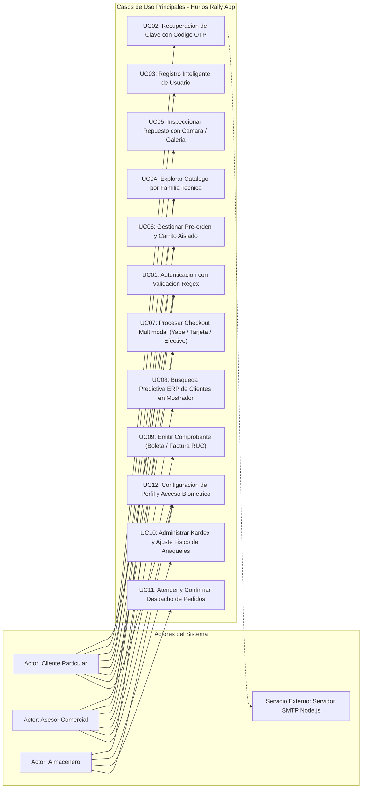
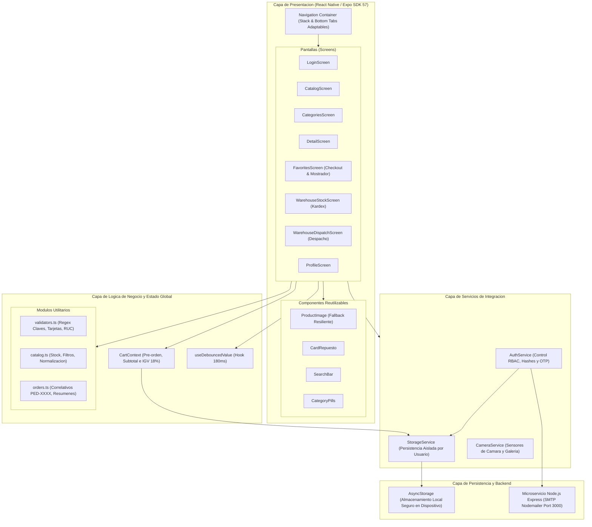
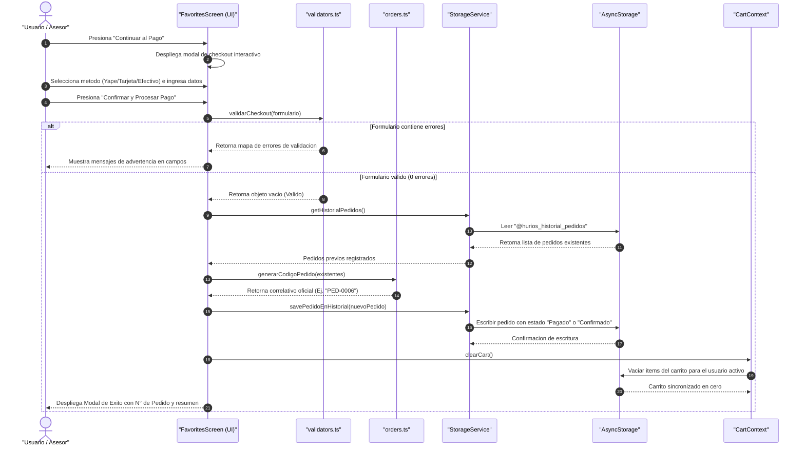
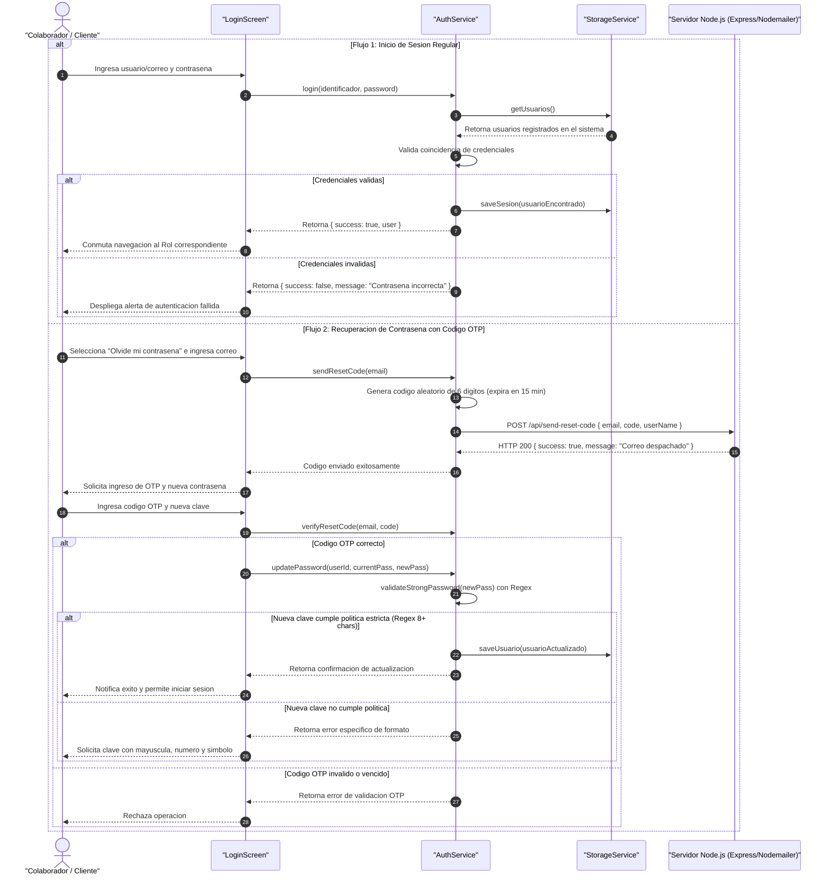
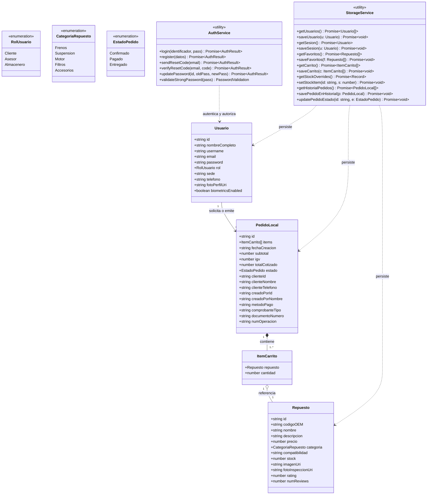
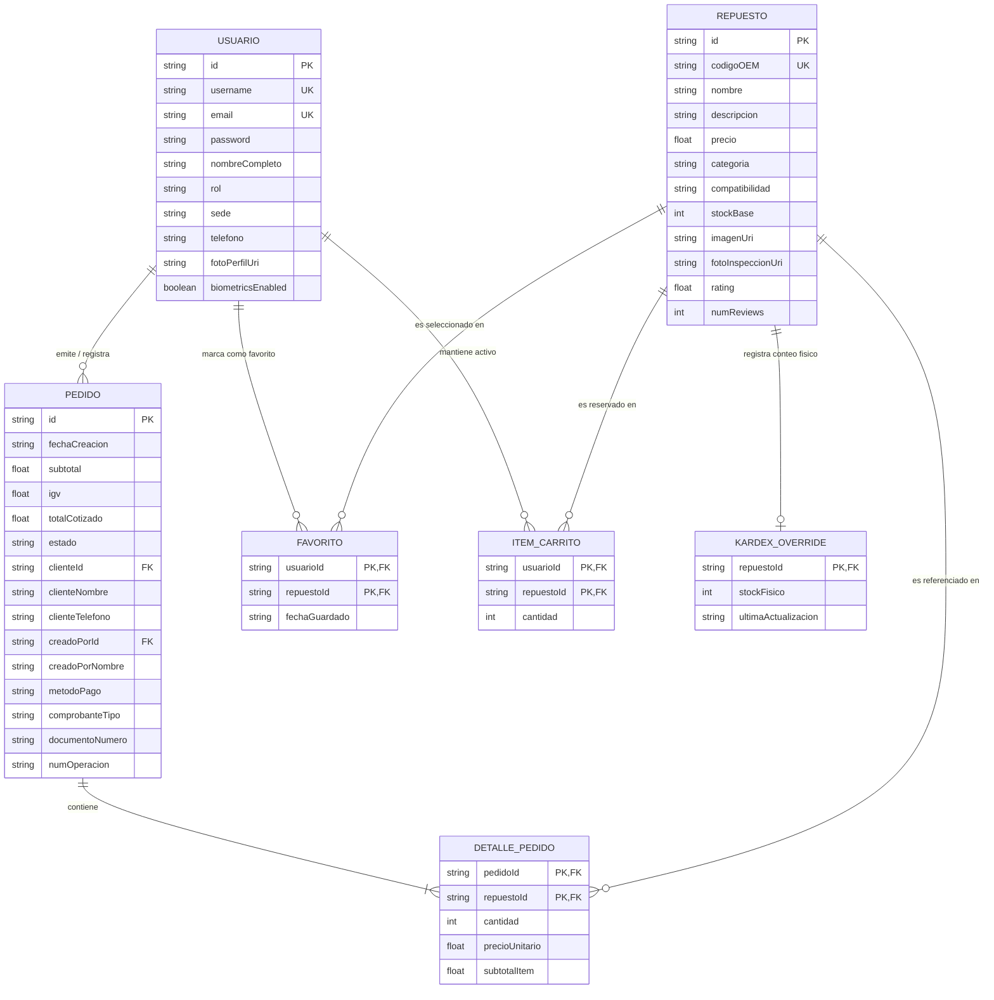
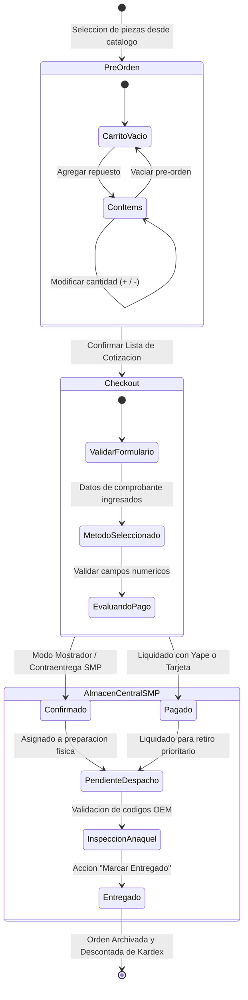
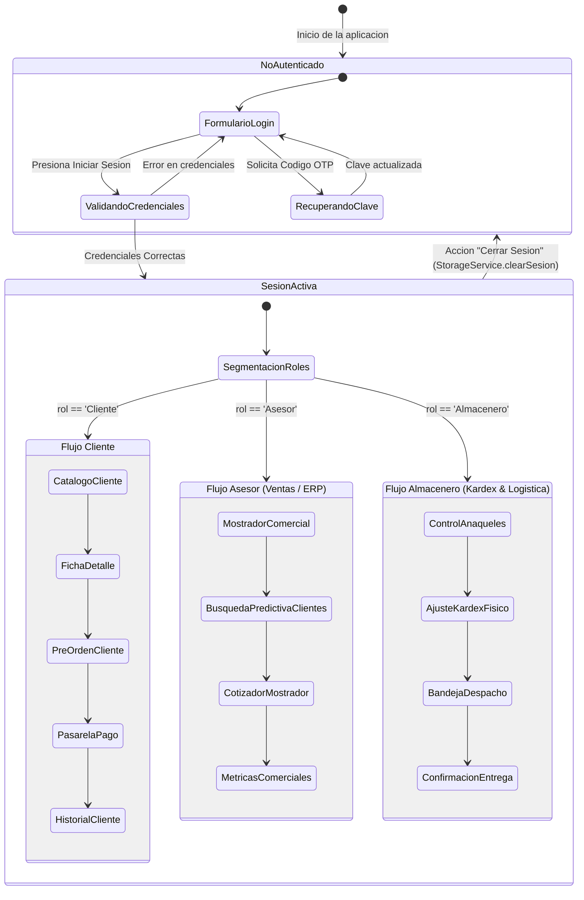
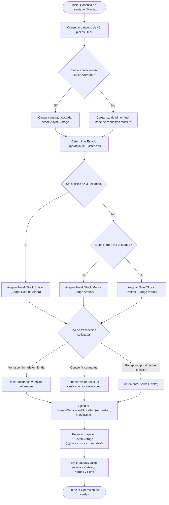

# Especificación de Diagramas de Ingeniería de Software

**Proyecto:** Hurios Rally App  
**Entidad Titular:** HURIOS RALLY E.I.R.L.  
**Estándar Aplicado:** UML 2.5 / C4 Model / ISO/IEC/IEEE 29148  
**Fecha de Publicación:** 2026  

---

## 1. Introducción y Metodología de Modelado

Este documento reúne el conjunto de artefactos de modelado estructural y de comportamiento del sistema **Hurios Rally App**. Los diagramas han sido elaborados utilizando la sintaxis estándar de **Mermaid**, permitiendo su renderizado nativo en repositorios Git y herramientas de integración continua.

El modelado abarca las siguientes dimensiones de ingeniería:
- **Vista Funcional:** Casos de uso e interacción de actores.
- **Vista Estructural:** Arquitectura en capas, clases del dominio y entidad-relación.
- **Vista Dinámica:** Diagramas de secuencia y flujos de actividades.
- **Vista de Comportamiento:** Máquinas de estados finitos para ciclo de vida de órdenes y sesiones RBAC.

---

## 2. Diagrama de Casos de Uso del Sistema (UML Use Case)

### Descripción
El sistema interactúa con tres actores humanos primarios con roles segregados (**Cliente**, **Asesor de Ventas** y **Almacenero**) y un actor secundario externo correspondiente al **Servicio SMTP Node.js** para el despacho de códigos OTP.

---

## 3. Diagrama de Arquitectura de Capas y Componentes

### Descripción
La solución aplica una arquitectura en capas desacoplada. La interfaz de usuario móvil consume estados reactivos globales y delega la persistencia a módulos utilitarios y servicios aislados de infraestructura.

---

## 4. Diagramas de Secuencia (Interacción Cronológica)

### 4.1. Flujo de Emisión de Cotización y Checkout
Describe el proceso mediante el cual un usuario o asesor valida los datos del cliente, calcula los impuestos de ley (IGV 18%), registra la orden correlativa y vacía la pre-orden activa.

### 4.2. Flujo de Autenticación y Recuperación con Código OTP
Describe la verificación de directivas de complejidad en contraseñas y la comunicación con el microservicio SMTP.

---

## 5. Diagrama de Clases del Dominio (UML Class Diagram)

### Descripción
Representa los contratos de datos (interfaces), enumeraciones y servicios utilitarios implementados en TypeScript.

---

## 6. Diagrama de Entidad - Relación (ER Diagram)

### Descripción
Modelo conceptual y lógico que define la integridad referencial y las llaves primarias/foráneas en el motor de persistencia.

---

## 7. Diagramas de Máquinas de Estados

### 7.1. Ciclo de Vida del Pedido y Proceso de Despacho
Modela las fases por las que transita una orden desde el ensamblado de la pre-orden hasta la entrega material de los repuestos en el mostrador de San Martín de Porres.

### 7.2. Estados de Sesión y Control de Acceso basado en Roles (RBAC)
Ilustra el bloqueo de navegación y la conmutación de paneles según el rol del colaborador activo.

---

## 8. Diagrama de Actividades: Flujo del Control de Inventario y Kardex

### Descripción
Detalla el algoritmo de determinación de existencia física en anaquel, categorización visual preventiva (óptimo, medio, crítico) y persistencia reactiva.

---

## 9. Patrones de Diseño Implementados

1. **Singleton & Facade (`StorageService` y `AuthService`):** Proporcionan puntos únicos de acceso simplificado a subsistemas complejos de almacenamiento asíncrono y encriptación.
2. **Observer / Context Provider (`CartContext`):** Desacopla la vista de los cálculos comerciales, notificando automáticamente a todas las pantallas dependientes cuando se alteran las cantidades o el inventario.
3. **Debounce Pattern (`useDebouncedValue`):** Reduce la carga de CPU y la degradación de fotogramas por segundo (FPS) al diferir el filtrado de listas complejas hasta que el usuario pause la escritura durante 180 ms.
4. **Strategy Pattern (`validators.ts`):** Encapsula familias de algoritmos de validación (Regex de contraseñas, formato Luhn para tarjetas y validación tributaria de RUC) bajo interfaces uniformes.
