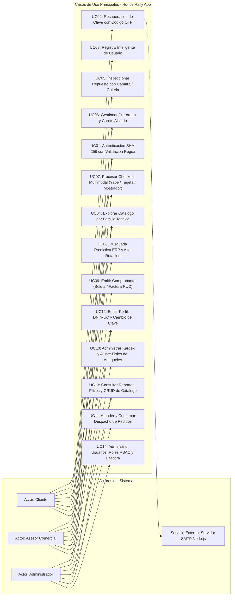
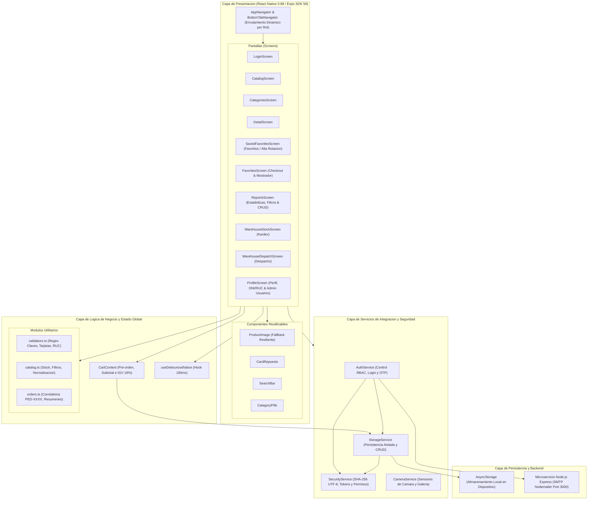
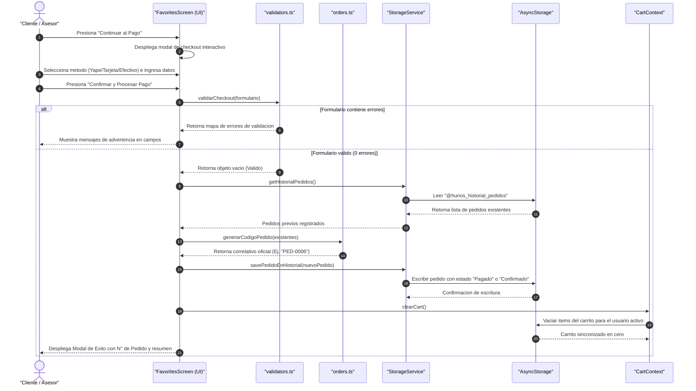
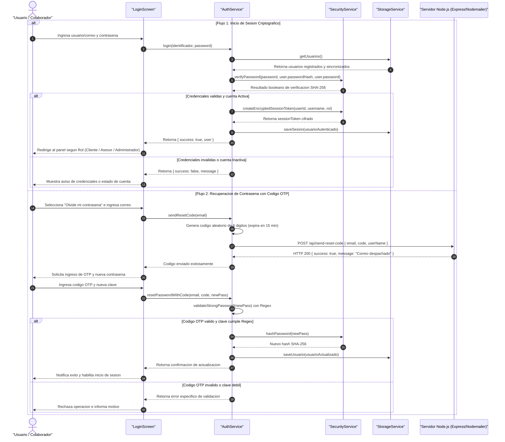
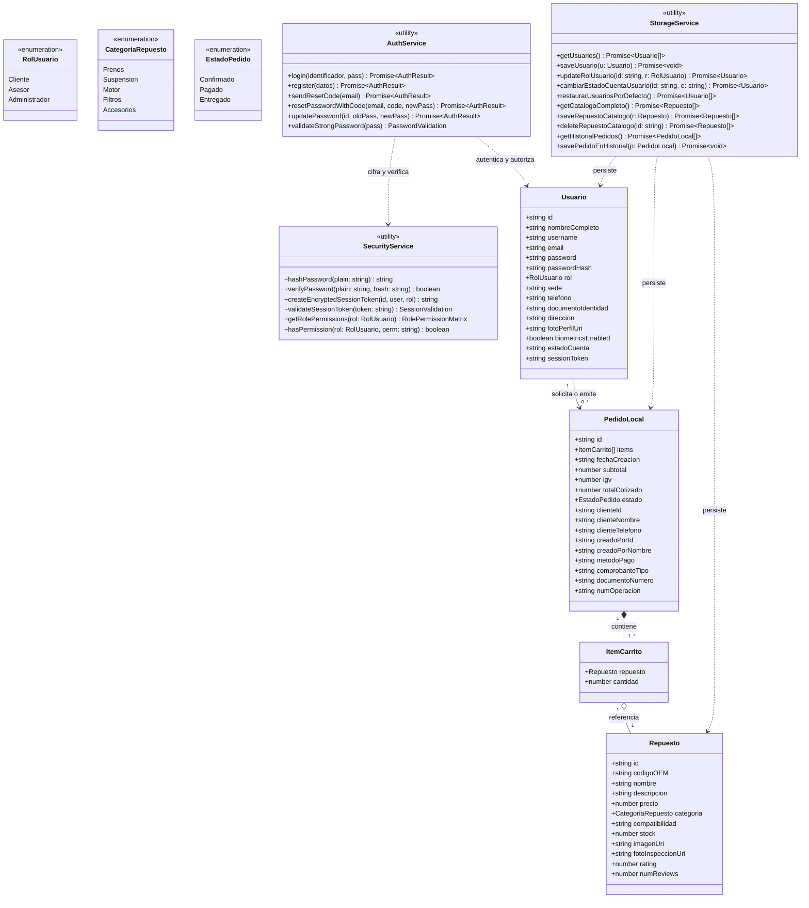
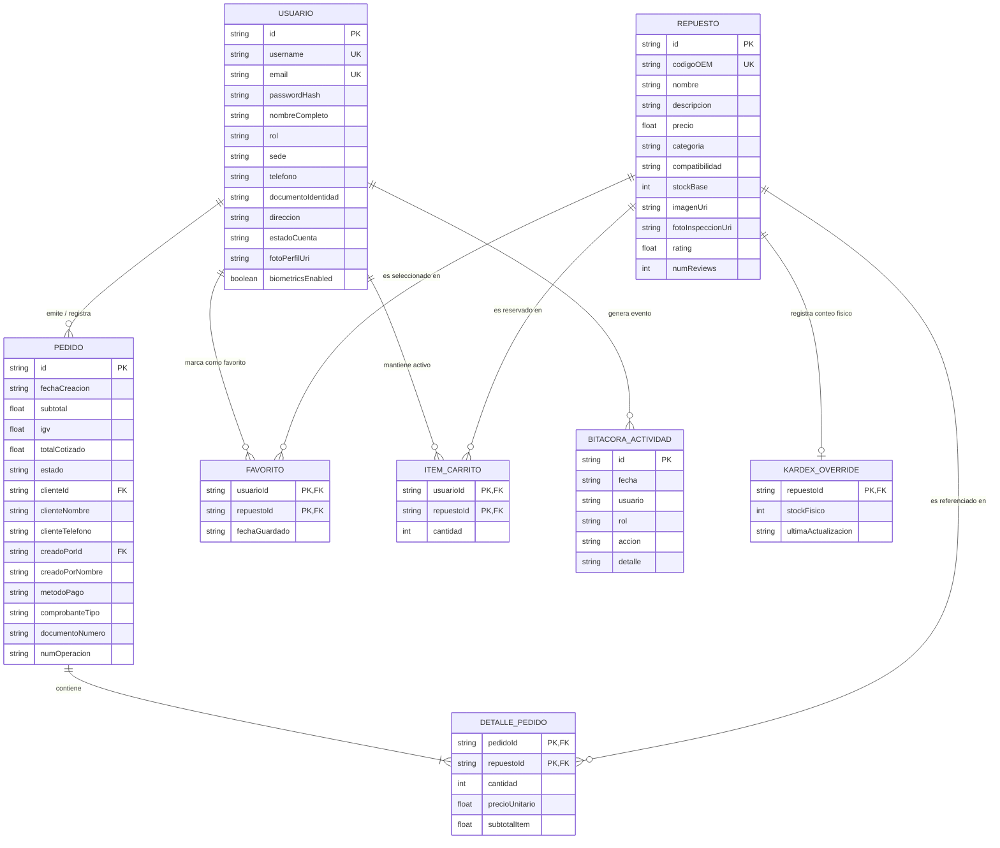
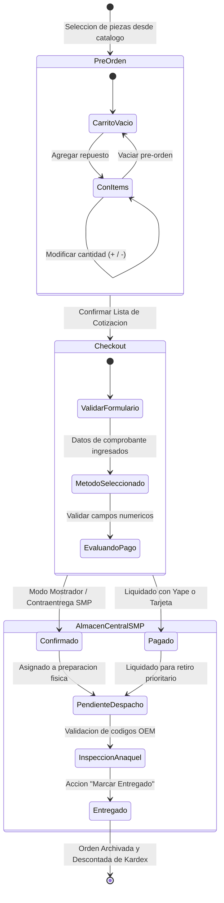
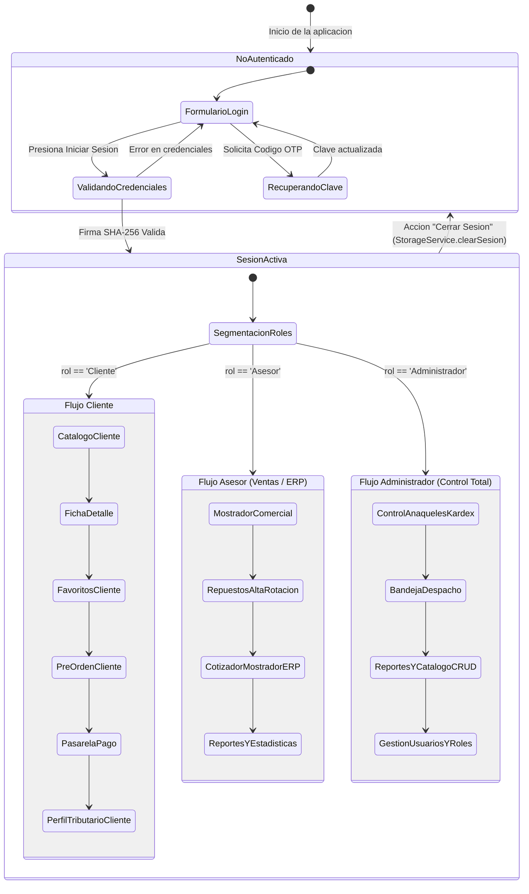
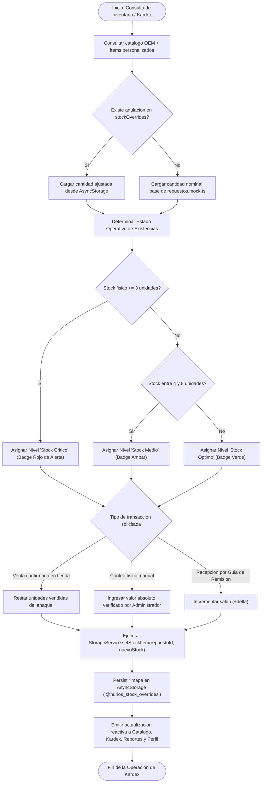

# Especificación de Diagramas de Ingeniería de Software

**Proyecto:** Hurios Rally App  
**Entidad Titular:** HURIOS RALLY E.I.R.L.  
**Estándar Aplicado:** UML 2.5 / C4 Model / ISO/IEC/IEEE 29148  
**Plataforma:** React Native 0.88.1 / Expo SDK 58  
**Fecha de Publicación:** 2026  

---

## 1. Introducción y Metodología de Modelado

Este documento reúne el conjunto de artefactos de modelado estructural y de comportamiento del sistema **Hurios Rally App**. Los diagramas han sido elaborados utilizando la sintaxis estándar de **Mermaid**, permitiendo su renderizado nativo en repositorios Git y herramientas de integración continua.

El modelado abarca las siguientes dimensiones de ingeniería:
- **Vista Funcional:** Casos de uso e interacción de los tres actores del negocio (`Cliente`, `Asesor` y `Administrador`).
- **Vista Estructural:** Arquitectura en capas, clases del dominio y entidad-relación.
- **Vista Dinámica:** Diagramas de secuencia (checkout, firma SHA-256 y recuperación OTP) y flujos de actividades.
- **Vista de Comportamiento:** Máquinas de estados finitos para ciclo de vida de órdenes y sesiones RBAC.

---

## 2. Diagrama de Casos de Uso del Sistema (UML Use Case)

### Descripción
El sistema interactúa con tres actores humanos primarios con roles segregados (**Cliente**, **Asesor Comercial** y **Administrador**) y un actor secundario externo correspondiente al **Servicio SMTP Node.js** para el despacho de códigos OTP.

---

## 3. Diagrama de Arquitectura de Capas y Componentes

### Descripción
La solución aplica una arquitectura en capas desacoplada sobre **React Native 0.88.1** y **Expo SDK 58**. La interfaz de usuario móvil consume estados reactivos globales y delega la seguridad criptográfica y la persistencia a módulos de servicio especializados.

---

## 4. Diagramas de Secuencia (Interacción Cronológica)

### 4.1. Flujo de Emisión de Cotización y Checkout
Describe el proceso mediante el cual un cliente o asesor valida los datos del comprobante, calcula los impuestos de ley (IGV 18%), registra la orden correlativa y vacía la pre-orden activa.

### 4.2. Flujo de Autenticación Criptográfica SHA-256 y Recuperación OTP
Describe la verificación de contraseñas firmadas con SHA-256, el control de estado de cuenta y la comunicación con el microservicio SMTP.

---

## 5. Diagrama de Clases del Dominio (UML Class Diagram)

### Descripción
Representa los contratos de datos (interfaces), enumeraciones y servicios utilitarios implementados en TypeScript.

---

## 6. Diagrama de Entidad - Relación (ER Diagram)

### Descripción
Modelo conceptual y lógico que define la integridad referencial y las llaves primarias/foráneas en el motor de persistencia local.

---

## 7. Diagramas de Máquinas de Estados

### 7.1. Ciclo de Vida del Pedido y Proceso de Despacho
Modela las fases por las que transita una orden desde el ensamblado de la pre-orden hasta la entrega material de los repuestos en el mostrador de San Martín de Porres.

### 7.2. Estados de Sesión y Control de Acceso basado en Roles (RBAC)
Ilustra el bloqueo de navegación y la conmutación de paneles según el rol del usuario activo (`Cliente`, `Asesor` o `Administrador`).

---

## 8. Diagrama de Actividades: Flujo del Control de Inventario y Kardex

### Descripción
Detalla el algoritmo de determinación de existencia física en anaquel, categorización visual preventiva (óptimo, medio, crítico) y persistencia reactiva.

---

## 9. Patrones de Diseño Implementados

1. **Singleton & Facade (`StorageService`, `AuthService` y `SecurityService`):** Proporcionan puntos únicos de acceso simplificado a subsistemas de almacenamiento asíncrono, firma criptográfica SHA-256 y control de permisos RBAC.
2. **Observer / Context Provider (`CartContext`):** Desacopla la vista de los cálculos comerciales, notificando automáticamente a todas las pantallas dependientes cuando se alteran las cantidades o el inventario.
3. **Debounce Pattern (`useDebouncedValue`):** Reduce la carga de CPU y la degradación de fotogramas por segundo (FPS) al diferir el filtrado de listas complejas hasta que el usuario pause la escritura durante 180 ms.
4. **Strategy Pattern (`validators.ts`):** Encapsula algoritmos de validación (Regex de contraseñas, formato de tarjetas, teléfonos de 9 dígitos y validación tributaria de DNI/RUC) bajo interfaces uniformes.
